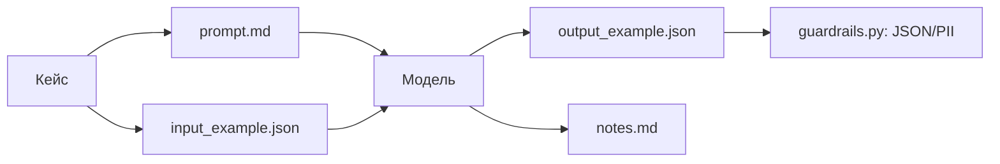

# Portfolio Cases

Кейсы применения промт-инжиниринга и LLM для решения практических задач.

## Список кейсов
1. **case_01_review_analysis** — анализ отзывов клиентов с помощью LLM.
2. **case_02_weekly_report** — генерация еженедельного отчёта по продажам.
3. **case_03_landing** — генерация структуры и текстов лендинга.

## Структура кейса
- `README.md` — описание проблемы, подхода и результата.
- `prompt.md` — использованный промт.
- `input_example.json` — пример входных данных.
- `output_example.json` — пример результата.
- `notes.md` — выводы и ограничения.

## Автор
redsea1970

## Оценка

Три кейса, каждый с полным набором артефактов (`README.md`, `prompt.md`, `input_example.json`, `output_example.json`, `notes.md`):

| Кейс | Задача | Артефакты | Что проверено |
|---|---|---|---|
| case_01_review_analysis | Анализ отзывов | 5 файлов | JSON-схема, категории, ограничения (сарказм) |
| case_02_weekly_report | Еженедельный отчёт | 5 файлов | структура отчёта, входные данные |
| case_03_landing | Структура лендинга | 5 файлов | тексты, структура |

**Итог:** 3 из 3 кейсов укомплектованы; в каждом `notes.md` зафиксированы «что сработало», «ошибки и ограничения», «улучшения».

## Ограничения

- Кейсы демонстрационные: `output_example.json` — это пример, а не результат реального вызова LLM (нет API-ключей).
- `prompt.md` в кейсах и `prompts.py` в корне дублируют друг друга: для production лучше хранить промпты только в `prompts.py`.
- `notes.md` фиксирует ограничения (сарказм, ручная проверка), но автоматической оценки (accuracy, F1) нет.
- Для production нужно: подключить реальную модель, добавить конвейер оценки (AI-судья), валидировать JSON программно (см. `guardrails.py`).

## Архитектура

